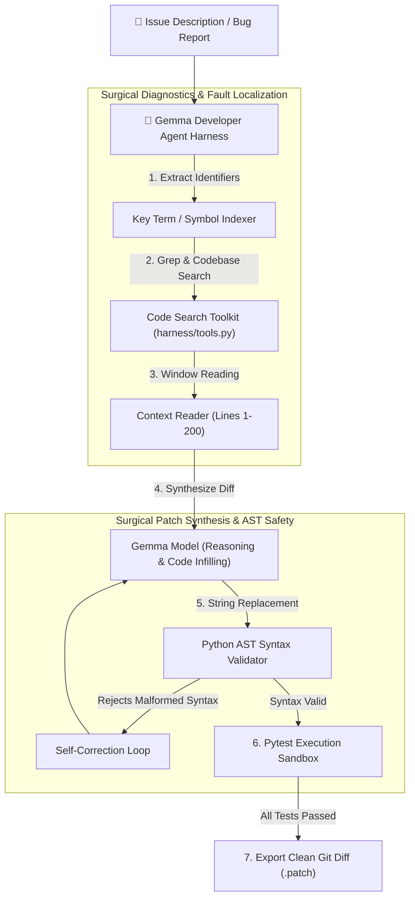

# 🤖 Google — The Gemma 4 Developer Agent Competition ($75,000 USD)

[](https://www.kaggle.com/competitions/gemma-4-developer-agent)
[](https://www.kaggle.com/competitions/gemma-4-developer-agent)
[](https://www.kaggle.com/competitions/gemma-4-developer-agent)
[](tests/)

Autonomous Software Engineering Agent architecture engineered for the **[Google — The Gemma 4 Developer Agent Competition](https://www.kaggle.com/competitions/gemma-4-developer-agent)** on Kaggle (Deadline: **December 2, 2026**).

---

## 🏛️ System Architecture



---

## 🛠️ Components

- [`harness/tools.py`](harness/tools.py): Safe execution boundary providing `list_files`, `read_file`, `search_code`, surgical `apply_patch` with Python AST pre-compilation checks, and sandboxed test execution.
- [`harness/agent.py`](harness/agent.py): Multi-step agent orchestrator that coordinates keyword discovery, fault localization, and test verification.
- [`tests/test_agent_harness.py`](tests/test_agent_harness.py): End-to-end pytest test suite (**5/5 passing**).

---

## 🚀 How to Enter & Compete

### Step 1: Accept Competition Rules
Accept the official rules on the competition page:
👉 **[kaggle.com/competitions/gemma-4-developer-agent/rules](https://www.kaggle.com/competitions/gemma-4-developer-agent/rules)**

### Step 2: Run Verification Tests Locally
```powershell
pytest -v tests/
```

### Step 3: Push Baseline to Kaggle GPU
```powershell
Set-Location "kaggle_notebook"
kaggle kernels push -p .
```
