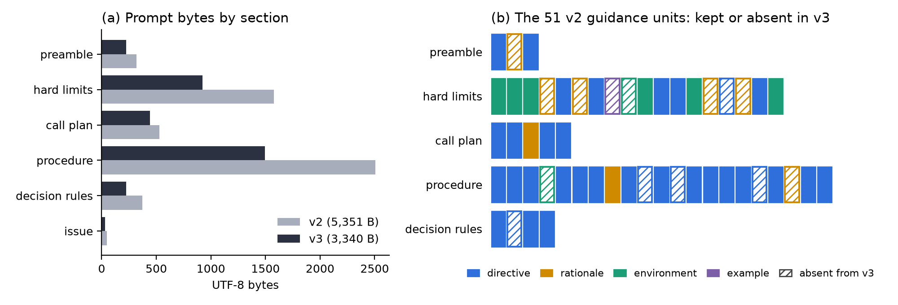
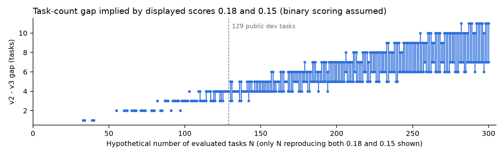

# What Prompt Compression Removes: Auditing a Gemma 4 Software Agent

**Subtitle:** Why a shorter system prompt is not evidence of a better agent, and what two leaderboard scores can resolve

**Author:** Akmal Shahbaz

**Companion notebook (version 10):** https://www.kaggle.com/code/akmalshahbaz/gemma-4-adk-kv-roofline-power-companion (the URL keeps an earlier working title)

## Abstract

In the Gemma 4 Developer Agent competition the model and agent loop are fixed, so the system prompt is the main design surface, and shortening it is a common move. We made our agent's prompt 37.6% shorter, with three smaller changes, and its public score fell from 0.18 to 0.15. Rather than explain the drop, we ask what the compression removed and what two scores can resolve. An audit of 51 guidance units shows that nearly all directives survived (29 of 34) but many rationales did not (6 of 8 by our labels, 3 to 4 of 8 by an independent second rater), along with four repair heuristics; rationales were dropped roughly three to six times as often as directives under every labelling we tried. Assuming pass/fail grading, the score gap is one to four tasks, within documented run-to-run variation for software agents, so the data cannot show that compression caused the drop. We treat the audit as a hypothesis, specify the experiment that would test it, and release code that regenerates every figure. Prompt compression should be described by what it removes, not only by how much, and judged with repeated, controlled runs.

## 1. Introduction

Repository-level software repair asks a language-model agent to read an issue, locate the relevant code, edit it and verify the edit within a fixed budget of tool calls and time [3, 4]. In the Gemma 4 Developer Agent competition [1] the organisers fix the model, inference stack and agent loop; participants submit a declarative bundle with the agent's tools, sampling parameters, budgets and a system prompt. Without an optional LoRA adapter, the prompt and tool list are the main levers. This report is a submission to the competition's paper track [2].

Shortening the prompt is a natural move. It leaves more context for file contents and test output, and recent work suggests that a moderate share of instruction text can be removed with little loss, although reliability degrades under heavier compression [6, 7, 8]. Our v2 configuration used a detailed prompt. v3 rewrote it to be substantially shorter, removed three tool declarations the prompt already told the model not to use, raised the temperature and added a minute to the time budget. It scored lower.

A lower score invites a quick explanation, such as that the prompt became too terse. That is premature, as is the opposite claim that the change was noise. Both skip a prior question: what did the rewrite take out? Compression is usually described by how much text it saves; we describe it by what it removes. We contribute an instruction-level audit of the rewrite with a robustness analysis of its labels, a bound on what two rounded leaderboard scores can resolve, and a separation of measured facts from hypotheses together with the experiment that would test the leading one.

## 2. Related Work

**Software-engineering agents.** SWE-bench [3] established evaluation on real GitHub issues judged by tests. SWE-agent [4] showed that the agent–computer interface, meaning the tools given and how output is presented, strongly affects resolution rates, and SWE-smith [5] scaled training environments for such agents.

**Prompt and context compression.** LLMLingua-2 [6] learns which prompt tokens can be dropped while preserving task performance. Hou and Yang [7] compress the control context of tool-using agents, the system-side text specifying tools and policies, and find that success stays near the full-context baseline when most context is retained but diverges sharply under stronger compression, with failures mainly in tool execution and action parsing. Gao et al. [8] compress skill descriptions for coding agents and report that removing non-essential content can improve results. These studies measure how much text can be removed; we ask what kind a hand-written compression removed. The kind may matter: explanations attached to examples can improve large models [10], and models are sensitive to small changes in prompt wording and format [9].

**Variance in agent evaluation.** Miller [11] argues that evaluations should report standard errors and account for sampling variability. Bjarnason et al. [12] ran tens of thousands of agent trajectories on SWE-bench Verified and found single-run scores differing by several points depending on which run is chosen, even at temperature zero, so that reported gains of two to three points may be noise. Our observed difference is of that size.

## 3. Experimental Setup

**Competition setting.** All configurations use the competition's quantised Gemma 4 31B instruction-tuned model without an adapter. For each hidden issue the runner executes the agent in an offline container and grades the resulting working-tree diff against hidden tests [1]. The leaderboard reports one score per submission, with no per-task outcomes.

**Configurations.** Table 1 lists four configurations: v2 (control), v3 (compressed revision), and v4 and v5, one-factor variants of v2 prepared to separate what v3 bundled. All share the same tool-call, output-length and thinking budgets. The three tools removed in v3 and v4 provide code-graph navigation and similarity search; the v2 prompt already forbade them because the graphs omit asynchronous code.

**Table 1. Configurations and leaderboard outcomes.**

| Configuration | Difference from v2 | Prompt size | Public score |
|---|---|---|---|
| v2 (control) | — | 5,351 bytes | 0.18 |
| v3 | Prompt rewritten; three graph tools removed; temperature 0.2 → 0.4; time budget 7 → 8 minutes | 3,340 bytes | 0.15 |
| v4 | Three graph-tool declarations removed only | 5,351 bytes | Pending |
| v5 | Temperature 0.2 → 0.0 only | 5,351 bytes | Not yet evaluated |

## 4. Methodology

**Development data and prompt measurement.** The competition provides 129 public development tasks. Our notebook loads the official task file, records its checksum and measures each assembled prompt, with the problem statement inserted, in UTF-8 bytes. We did not run the tokenizer, and the measurement excludes tool schemas, reasoning and tool output.

**Instruction-level audit.** We divided the v2 prompt into 51 guidance units, each expressing one idea, and classified each as a directive (what to do or avoid), a rationale (why a directive exists), an environment fact (a property of the sandbox or tools) or an example. Each unit carries a verbatim quotation from v2 and, if the guidance survives, one from v3; the code fails if any quotation is absent from the submitted prompts. The segmentation and labels were drafted with an AI assistant, so they are a documented judgement, not a validated measurement. To check them, a second AI model labelled the same units blind: it saw only the two prompts, the category definitions and our verbatim v2 excerpts, never our labels, and judged each unit's kind and whether its idea survives in v3. We also recomputed the contrast between rationales and directives under labellings that a different rater could defend: counting as rationales three environment facts that also explain a nearby rule, counting as retained two units that v3 keeps in part, doing both, and excluding guidance about the removed graph tools, which became moot rather than lost.

**Score-resolution analysis.** The leaderboard shows two decimal places and does not publish the number of evaluated tasks. Assuming each task is graded pass or fail and scores are rounded pass rates, we enumerate the evaluation sizes at which both observed scores can occur and the task gap each implies. We also compute how large an evaluation must be for a difference this size between two independent runs to exceed two standard errors [11]. A paired comparison would need per-task outcomes, which we lack.

**Configuration validity.** The notebook compiles v3 with the official submission package without running a model, which shows only that it is well-formed; our tests check the bundle rules for all four configurations.

## 5. Results

### 5.1 Leaderboard outcome

v2 scored 0.18 and v3 scored 0.15 on the public leaderboard. Because v3 changed four things at once and each configuration was evaluated once, these scores do not identify which change, if any, caused the difference. We retain v2.

### 5.2 What the compression removed

Across the 129 development tasks the median assembled prompt shrank from 5,750 to 3,739 bytes. Figure 1(a) shows that most of the saving came from the two longest sections, the procedure and the hard limits; Figure 1(b) shows what was inside them.

**Figure 1.** (a) Prompt size by section; the v3 "workflow" section corresponds to the v2 "procedure" section. (b) The 51 guidance units of v2, coloured by kind. Solid squares survive in v3; hatched squares are absent from it.

By our labels, directives were largely preserved (29 of 34 survive) while rationales were largely removed (only 2 of 8 survive). The removed rationales said that the hidden tests were written from the issue text, that an edit left on disk is graded even without a submission, that test files are reset before grading, that a plain diff hides new files, and that test output should be read from the end because the verdict is printed last. A sixth, explaining why the graph tools were banned, became moot.

The last case shows the pattern. v2 told the model that command output is truncated to its first 5,000 characters while pytest prints its verdict at the end, and to save test output to a file and read only its tail. v3 keeps the truncation fact and the tail instruction but drops the sentence connecting them. A model following v3 usually does the right thing; a model facing an unfamiliar tool no longer has the reason in front of it.

Five directives were also removed: the moot graph-tool ban and four repair heuristics, namely to create new files only when a new module is needed, to fix the root cause, to judge success by the tests covering the modified code, and to edit where wrong behaviour is produced rather than observed.

### 5.3 Robustness of the audit

The counts depend on our labels, but the direction does not. Across the four alternative labellings of Section 4, 5 to 6 rationales were dropped out of 7 to 11, and 4 to 5 directives out of 33 to 34, so rationales were dropped roughly four to six times as often as directives.

The independent second rater agreed with our unit labels on 47 of 51 units (Cohen's kappa 0.84) and with our judgement of which units v3 dropped on 49 to 51, depending on how partly retained units are counted. All four label disagreements fall on the boundary between rationales and environment facts. Under its labels, 3 to 4 of 8 rationales were dropped against 5 of 34 directives, a ratio of roughly three rather than five. It flagged eight further fragments, but seven are present in v3 and one duplicates a labelled unit, so none changes the rationale counts. The audit therefore supports a qualitative statement, that this rewrite removed explanations considerably more readily than instructions, not a precise rate.

### 5.4 What two scores can resolve

**Figure 2.** For every evaluation size at which both observed scores are possible under pass/fail grading, the range of task-count differences between v2 and v3.

If the public evaluation is no larger than the 129-task development set, the two scores differ by between one and four tasks, and the evaluation would need well over a thousand tasks for a gap this size between independent runs to exceed two standard errors. Some sizes are ruled out: no pass count out of 58 tasks rounds to 0.18, contradicting the 58-task public split assumed in an earlier draft. Since Bjarnason et al. [12] report single-run variation of several points, a three-point gap between single runs is within what randomness alone can produce. We did not measure our own run-to-run variance, so we cannot say how much of the gap it explains.

### 5.5 Controlled follow-up

v4 is v2 minus the three unused tool declarations; we decided in advance that it would replace v2 only if it scored strictly higher, though a higher score would be weak evidence. v5 (temperature only) could not be evaluated because of the daily submission limit, and v4 was still pending at our last check, so we make no claim about either.

## 6. Discussion

The scores cannot show that compression hurt, and the audit cannot show that the removed text mattered. Together they establish that the rewrite was a specific intervention, one that removed reasons and several heuristics while leaving instructions largely intact, and that the single observation it produced is too coarse to judge it.

A plausible mechanism is that rationales help a model apply a rule to cases it did not anticipate, as an agent must in an unfamiliar repository. This is a hypothesis: explanations help large models in few-shot settings [10], but we have no evidence for instructions in a system prompt, and the dropped heuristics, the higher temperature or the extra time could equally explain the drop. Table 2 summarises the evidence.

**Table 2. Status of claims and what would settle them.**

| Status | Claim | What would settle it |
|---|---|---|
| Measured | Prompt sizes; which guidance units the rewrite removed; the labels' sensitivity and second-rater agreement | — |
| Verified | Both scores; v3 compiles; v4 and v5 each change one file | — |
| Derived from an assumption | The gap is one to four tasks for evaluations up to 129 tasks | Per-task outcomes |
| Hypothesis | Removing rationales and repair heuristics lowered repair quality | Restore them to v3; repeated runs |
| Hypothesis | The higher temperature made v3 less reliable | v5; repeated runs of v2 |
| Hypothesis | Declaring unused tools costs performance | v4; repeated runs of v2 |
| Withdrawn | Token-level savings; memory and compaction effects; public–private rank-reversal probabilities | Tokenizer measurement; runner-level traces; a valid task split |

The decisive experiment is simple: restore the removed rationales and heuristics to v3, change nothing else, and evaluate v2, v3 and the restored variant several times each, comparing task by task where outcomes are available [11]. If the restored variant recovers most of the gap, the audit found something that matters; if not, the tool, temperature and time changes become the main suspects, and v4 and v5 are prepared to test them one at a time. We will report the result either way. The method is not specific to our prompt: any rewrite of a system prompt, skill file or tool description can be audited unit by unit and relabelled by a second rater.

## 7. Limitations

Each configuration was evaluated once, private scores and per-task outcomes are unavailable, and v3 changed four factors together. The audit labels were drafted with an AI assistant and checked only by a second AI model, which labelled our segmentation rather than producing its own; no human has checked them, and Section 5.3 bounds that dependence without removing it. The audit covers one prompt and one model and may not generalise. The score analysis assumes pass/fail grading, and the development tasks may not resemble the hidden ones. We measured bytes, not tokens, and ran no inference, so we make no latency, memory or compaction claims.

## 8. Conclusion

A substantially shorter system prompt, introduced with three other changes, was followed by a slightly lower leaderboard score. The compression removed mainly explanations and a few repair heuristics while keeping nearly every instruction, a pattern that holds under every labelling we tried, including a second rater's, though its strength varies, and the score difference amounts to a few tasks, within what randomness can produce. Prompt revisions should be described by what they remove as well as by how much, and judged by repeated, controlled evaluation. We keep v2 and release our code so the restoration experiment can be run and checked.

## Reproducibility Statement

The public companion notebook contains the v2 and v3 configurations and the analysis code, and reproduces the measurements, the audit with its sensitivity analysis, the score analysis, both figures and the official v3 compilation on Kaggle CPU. Our repository, which also holds the second rater's labels and the agreement analysis and runs the test suite, is available on request.

## AI Assistance

An AI assistant (Claude) helped write the analysis code, draft the instruction labels and draft the text of this paper; a second Claude model provided the independent labelling. All reported numbers were regenerated from the archived configurations and checked against the Kaggle outputs.

## References

1. Google DeepMind and Kaggle. The Gemma 4 Developer Agent Competition, 2026. https://www.kaggle.com/competitions/gemma-4-developer-agent
2. Google DeepMind and Kaggle. The Gemma 4 Developer Agent Paper Track, 2026. https://www.kaggle.com/competitions/gemma-4-developer-agent-paper
3. C. E. Jimenez et al. SWE-bench: Can Language Models Resolve Real-World GitHub Issues? ICLR 2024. https://arxiv.org/abs/2310.06770
4. J. Yang et al. SWE-agent: Agent-Computer Interfaces Enable Automated Software Engineering. NeurIPS 2024. https://arxiv.org/abs/2405.15793
5. J. Yang et al. SWE-smith: Scaling Data for Software Engineering Agents. NeurIPS 2025. https://arxiv.org/abs/2504.21798
6. Z. Pan et al. LLMLingua-2: Data Distillation for Efficient and Faithful Task-Agnostic Prompt Compression. arXiv:2403.12968, 2024. https://arxiv.org/abs/2403.12968
7. Y. Hou and Z. Yang. Control Under Compression: Reliability Frontiers for Tool-Using Agents. arXiv:2608.01056, 2026. https://arxiv.org/abs/2608.01056
8. Y. Gao et al. SkillReducer: Optimizing LLM Agent Skills for Token Efficiency. arXiv:2603.29919, 2026. https://arxiv.org/abs/2603.29919
9. M. Sclar et al. Quantifying Language Models' Sensitivity to Spurious Features in Prompt Design. ICLR 2024. https://arxiv.org/abs/2310.11324
10. A. K. Lampinen et al. Can Language Models Learn from Explanations in Context? Findings of EMNLP 2022. https://arxiv.org/abs/2204.02329
11. E. Miller. Adding Error Bars to Evals: A Statistical Approach to Language Model Evaluations. arXiv:2411.00640, 2024. https://arxiv.org/abs/2411.00640
12. B. H. Bjarnason, A. Silva and M. Monperrus. On Randomness in Agentic Evals. ICLR 2026. https://arxiv.org/abs/2602.07150
